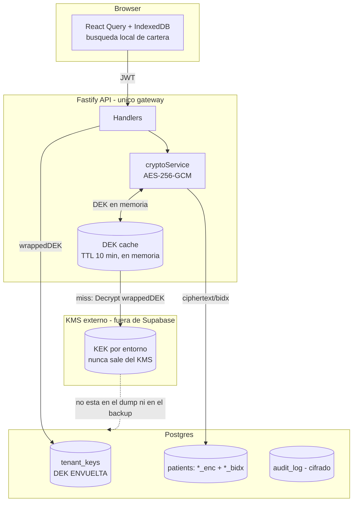

# Auditoría de seguridad y plan de cifrado de datos sensibles — DentalOS

> Documento vivo. Se itera **por fases** (ver §11 y los checklists `[ ]`).
> Fecha de auditoría inicial: 2026-10-19. Autor: auditoría de código (Claude).
> Revisión complementaria: 2026-10-19 (Codex), contrastada con frontend y backend.
> Los hallazgos agregados son de revisión estática; no se probaron contra producción.
>
> **Alcance**: cómo DentalOS almacena/procesa/expone datos de pacientes y diseño de
> protección criptográfica para minimizar el impacto de una filtración de la base.
> **Pregunta guía**: si roban un dump completo de Postgres, ¿qué se lee hoy, qué se
> leería después de esta propuesta, y qué más habría que comprometer para descifrar?

Convención: **[H]** = hecho verificado en código · **[I]** = inferencia · **[?]** = hipótesis a confirmar.

---

## 1. Executive Summary

**[H] Hoy no existe ningún cifrado a nivel de aplicación ni de columna.** La extensión
`pgcrypto` está habilitada (`001_core_schema.sql:8`) pero **nunca se usa**; los comentarios
`-- encrypted at rest via Supabase Vault in prod` (`002_patients.sql:29`) y
`-- encrypted in prod` (`003_appointments.sql:36`) son **aspiracionales y falsos** — no hay
Vault, ni `pgp_sym_encrypt`, ni `crypto` de Node (grep sobre `src/` + migraciones: solo esas
3 coincidencias, todas comentarios o el `CREATE EXTENSION`).

Consecuencia directa: **si roban el dump de Postgres, el atacante lee hoy el 100% de la
información clínica y personal en texto plano** — nombres, DNI, teléfonos, alergias,
medicación, notas médicas, diagnósticos, odontogramas, consentimientos firmados (con IP y
firma), y además **las claves privadas AFIP (PEM) de cada profesional**
(`professionals.afip_cert/afip_key`, `034_afip_invoices.sql:8-9`). El único control vigente es
**RLS + autorización basada en JWT**, cuya efectividad depende de la confiabilidad de los
claims usados (ver hallazgo de `user_metadata` debajo). Estos controles **no protegen contra
un dump físico, un backup robado, o el robo de la `service_role` key**.

Severidad global del almacenamiento: **Alta**, con un **hallazgo potencialmente crítico de
autorización**. Verificar la firma del JWT no demuestra que sus claims de autorización sean
confiables. La arquitectura permite introducir *envelope encryption*, pero primero hay que
corregir la fuente de permisos, cerrar accesos cross-tenant y migrar las lecturas directas de
Next.js a Supabase. No se considera demostrado el aislamiento entre clínicas.

**Hallazgos que deben corregirse ANTES del cifrado (Fase 0):**
0. **[H] Autorización basada en datos editables por el usuario**: `server.ts:123-125` toma
   `clinic_id`, `professional_id` y `role` de `user_metadata`; `current_clinic_id()` también
   acepta esa fuente (`027:25-35`). **[I] Posible cambio de clínica/escalamiento de permisos**
   salvo controles adicionales de producción no inspeccionados. Es la primera prioridad.
1. **[H] Acceso cross-tenant a archivos clínicos** (`patients/routes.ts:504-594`): los endpoints
   de archivos usan `supabaseAdmin` (bypassa RLS) y **nunca validan que el paciente `:id`
   pertenezca a la clínica del JWT**.
2. **[H] `audit_log` duplica todos los datos en claro** (`006:155-202`): guarda
   `to_jsonb(OLD/NEW)` completo de `patients`/`payments`/`appointments`, append-only y sin
   borrado. Cualquier esquema de cifrado que no lo contemple es inútil.
3. **[H] Claves privadas AFIP en texto plano** en la tabla `professionals`.
4. **[H] Cartera local sin separación por sesión ni limpieza implementada**:
   `patientsLocalDb.ts` usa una base distinta del caché React Query; limpiar este último no
   elimina la cartera. **[I] Riesgo de mezclar datos entre usuarios/clínicas en equipos compartidos.**
5. **[H] Copias sensibles omitidas o mal clasificadas**: HTML de consentimientos con nombre y
   DNI, receptores de facturas y snapshots de historias firmadas. Notificaciones también
   requieren una tarea de migración explícita. Sin cubrir esas copias, el dump sigue revelando
   identidades e información clínica aunque se cifre `patients`.

---

## 2. Arquitectura actual encontrada

**[H] Flujo de datos** (confirmado en `server.ts`, `lib/supabase.ts`, módulos):

```
Browser ──JWT Supabase (jose/JWKS)──> Fastify ──┬─ supabaseForUser(JWT) → RLS
  │                                         └─ supabaseAdmin → BYPASSA RLS
  ├─ Next.js Server Component ──> Supabase directo (paciente + historia clínica)
  ├─ IndexedDB dentalos-cache (React Query persist)
  └─ IndexedDB dentalos-patients (cartera + cursor de sincronización)
```

- **[H] Firma de JWT verificada, autorización insegura por su fuente**: `server.ts:112-139`
  usa `jwtVerify(token, JWKS)`, pero prioriza `user_metadata` para clínica, profesional y rol.
  Un JWT válido puede contener metadatos elegidos por el usuario. Supabase documenta que
  `user_metadata` es editable por usuarios autenticados y no debe usarse para autorización;
  `app_metadata` no es editable por ellos. Ver [documentación oficial de RLS](https://supabase.com/docs/guides/database/postgres/row-level-security#authjwt).
  **[?]** Verificar hooks y restricciones reales de Auth en un entorno de prueba; no se
  inspeccionó la configuración productiva. Migrar API y RLS a una fuente controlada por el
  servidor, sin conservar el fallback inseguro.
- **[H] Dos clientes DB** (`lib/supabase.ts`): `supabaseForUser` (respeta RLS, cacheado por
  token en un `Map` en memoria, TTL ~55min) y `supabaseAdmin` (service_role, **bypassa RLS**).
- **[H] Uso intensivo de `service_role`**: `auth` (16 usos), `professionals` (14),
  `notifications` (11), `booking` (9), `invoices`/`nave` (8), `patients` (7, todos en archivos).
  Cada uso de `supabaseAdmin` depende de un `.eq('clinic_id', …)` manual para no filtrar entre
  tenants.
- **[H] RLS**: activo en todas las tablas de tenant; política típica
  `FOR ALL USING (clinic_id = current_clinic_id())`. `current_clinic_id()` lee el claim del JWT
  con fallbacks a `user_metadata`/`app_metadata` (`027:25-35`), es `SECURITY DEFINER`.
- **[H] RPCs `SECURITY DEFINER` endurecidas** en `043`: `assert_clinic_access(p_clinic_id)`
  exige `p_clinic_id = current_clinic_id()` para usuarios autenticados y revoca `EXECUTE` de
  `PUBLIC`. Corrige la falta de validación documentada en `043`, pero sigue dependiendo de
  que `current_clinic_id()` derive la clínica de una fuente confiable.
- **[H] Dos almacenes locales diferentes**: `web/lib/queryClient.tsx:60-64` limpia React Query
  al recibir `SIGNED_OUT`. `web/lib/patientsLocalDb.ts` usa `dentalos-patients/kv`, con claves
  globales `patients` y `cursor`, sin borrado al logout ni separación por usuario/clínica.
  La sincronización fusiona la cartera existente con las filas recibidas. No se debe dar por
  válida la afirmación documental de que toda la cartera se elimina al cerrar sesión.
- **[H] Lecturas fuera de Fastify**: `web/app/(app)/patients/[id]/page.tsx:16-28` consulta
  `patients` y `patient_clinical_histories` desde Next.js directamente a Supabase. Esa carga
  inicial debe pasar por la API antes del piloto de cifrado; el diagrama de §7 es el objetivo.
- **[H] Redis también guarda resultados clínicos**: `patients/routes.ts` cachea ficha, turnos
  e historia; `treatments/routes.ts` cachea odontograma. Su contenido y retención deben formar
  parte del inventario de copias, aunque Redis no esté dentro del dump de Postgres.

---

## 3. Inventario de datos sensibles (tablas y columnas reales)

| Tabla / archivo | Columnas sensibles (texto plano hoy) | Fuente |
|---|---|---|
| `patients` | `first_name, last_name, document_type, document_number, date_of_birth, gender, phone, phone_alt, email, address, city, insurance_*, allergies, current_medications, medical_notes, blood_type, referral_source` | `002_patients.sql:9-34` |
| `patients` (JSONB) | historia clínica (alerts, antecedentes) — `ClinicalHistorySchema` | `patients/routes.ts:38-83` |
| `patient_clinical_histories` | tabla creada fuera de migraciones, RLS asegurada en `027:110-139` | `027` |
| `appointments` | `chief_complaint, clinical_notes, internal_notes, cancelled_reason` | `003:29-37` |
| `treatments` | `name, description, tooth_numbers/surfaces, abandon_reason` | `004:25-56` |
| `treatment_sessions` | `notes, next_steps` (qué se hizo en la sesión) | `004:76-77` |
| `odontogram` / `tooth_diagnostics` | `condition, surfaces, notes` por diente | `004:130-158`, `027:77-108` |
| `consents` | `content_html` renderizado con nombre y DNI, `signature_data` (imagen base64), `signer_ip`, `signer_ua` | `006:93-100`; `web/app/(app)/patients/[id]/consents/page.tsx:165-171,224-231` |
| `clinical_history_signatures` | `history_snapshot` (historia completa), `signature_data`, `signer_ip`, `signer_ua` | `036_clinical_history_signatures.sql:6-17` |
| `invoices` | `receptor_name`, `receptor_cuit`, `receptor_address`, vinculados mediante `patient_id` | `034_afip_invoices.sql` |
| `notifications` | `to_phone, to_email, template_vars (JSONB), rendered_body` (nombre + turno) | `006:35-42`; `notifications/service.ts:89-98` |
| `app_notifications` | `body` free-text con nombre completo del paciente | `notifications/inbox.ts:101-109` |
| `professionals` | `afip_cert` (PEM), `afip_key` (**clave privada PEM**), `email, phone, license_number` | `001:82-90`, `034:8-9` |
| `audit_log` | `old_data/new_data` = **fila completa** de patients/payments/appointments | `006:127-202` |
| Storage `patient-files` | radiografías, PDFs clínicos | `045` |
| IndexedDB (browser) | cartera: `id, first_name, last_name, phone, document_number`; React Query: datos de todas las queries exitosas, sin lista de exclusión de campos sensibles | `web/lib/patientsLocalDb.ts`; `web/lib/queryClient.tsx:76-78` |
| Redis | respuestas de ficha, turnos, historia clínica y odontograma | `patients/routes.ts:212,237,372`; `treatments/routes.ts:227` |

**Criterio de completitud**: inventariar cada copia y consumidor, no solamente la tabla
principal. Incluir históricos de auditoría, mensajes, snapshots, exportaciones, archivos,
cachés y backups. Los campos libres deben revisarse por contenido posible; su nombre no
garantiza ausencia de PII. Las tablas anteriores son evidencia de código, no un inventario
exhaustivo de la base productiva.

---

## 4. Clasificación de datos y matriz de riesgos

Criterio: **no cifrar indiscriminadamente**. Distingo **cifrar a nivel app (AEAD)**, **blind
index (HMAC)** para búsqueda exacta, **texto plano + control de acceso**, y **minimización**.

| Dato | Sensibilidad | Hoy | Recomendado | Impacto funcional / nota |
|---|---|---|---|---|
| `first_name`, `last_name` | Personal | plano + índice GIN | **Cifrar (AEAD)** + mover búsqueda al cliente (ya hay IndexedDB) | Búsqueda por nombre: ver §6 |
| `document_number` (DNI/CUIT) | Personal fuerte | plano + ILIKE | **Cifrar + blind index HMAC** (exacta) | Identificación / dedup |
| `phone`, `phone_alt` | Personal | plano, indexado | **Cifrar + blind index HMAC** (normalizado E.164) | WhatsApp: descifrar en el consumidor autorizado; evitar copiar plaintext a la cola |
| `email` | Personal | plano | **Cifrar + blind index** (opcional) | Login no usa este campo |
| `date_of_birth`, `gender`, `blood_type` | Personal/clínico | plano | **Cifrar (AEAD)** | Sin búsqueda; se muestran al abrir ficha |
| `allergies, current_medications, medical_notes`, historia JSONB | **Crítica (PHI)** | plano | **Cifrar (AEAD)** | Solo lectura al abrir ficha |
| `appointments.chief_complaint/clinical_notes/internal_notes` | **Crítica** | plano | **Cifrar (AEAD)** | Se ven en detalle de turno/paciente |
| `treatments.*notes`, `treatment_sessions.notes`, `odontogram.notes`, `tooth_diagnostics.notes` | **Crítica** | plano | **Cifrar (AEAD)** | Visualización ficha |
| `treatments.tooth_numbers`, `odontogram.condition` (enums) | Clínica media | plano | **Texto plano** (necesario para GIN/filtros; bajo valor aislado) | Odontograma se dibuja desde estos |
| `consents.content_html` (snapshot renderizado) | **Personal/clínica** | plano, incluye nombre y DNI | **Cifrar (AEAD)** | No confundir con la plantilla sin completar |
| `consents.signature_data` + `signer_ip/ua` | **Crítica (prueba legal)** | plano | **Cifrar (AEAD)** | Descarga PDF del consentimiento |
| `clinical_history_signatures.history_snapshot/signature_data/signer_ip/signer_ua` | **Crítica** | plano | **Cifrar (AEAD)** | Preservar el contenido del snapshot firmado |
| `invoices.receptor_name/receptor_cuit/receptor_address` | Personal | plano | **Cifrar (AEAD)** | Descifrar para emisión, consulta y exportación; importes pueden seguir en claro |
| Destinatarios, variables y mensajes de `notifications`; contenido identificable de `app_notifications` | Personal/clínica | plano | **Cifrar o minimizar**, con retención definida | Adaptar worker, reintentos e inbox |
| `professionals.afip_cert/afip_key` | **Secreto crítico** | plano | **Cifrar (AEAD) o KMS dedicado** | Firma AFIP; ver Fase 0 |
| `payments.amount`, importes | Financiera | plano | **Texto plano** (dashboards/sumas SQL); proteger con RLS | Cifrar rompería `finance_*` RPCs |
| `clinic.*`, enums, FKs, timestamps | Operacional | plano | **Texto plano** | Joins/filtros |

**[I] No cifrar**: importes y agregados financieros (los RPCs `finance_kpis/analytics/movements`,
`032`, `payments_summary_period` suman en SQL — cifrarlos obligaría a traer todo a la app), enums
clínicos usados en GIN/filtros, y columnas de relación/tiempo, sujeto a revisión de necesidad.
**Cifrar identificadores no garantiza anonimato**: FKs, fechas, diagnósticos y datos externos
pueden permitir correlaciones. Cada exclusión debe registrar su necesidad funcional y riesgo
residual. Cifrar `patients` sin proteger las copias identificables de §3 no cumple el objetivo.

---

## 5. Threat model y qué mitiga el cifrado

| # | Escenario | ¿Lo mitiga cifrado app-layer + KMS externo? | Control necesario |
|---|---|---|---|
| 1 | **Dump completo de Postgres** | ✅ Para campos cifrados y sus copias cubiertas; persisten datos y correlaciones en claro | Resolver inventario completo y `audit_log` histórico |
| 2 | Backups/snapshots robados | ✅ Para copias generadas tras completar la migración; los backups anteriores pueden contener plaintext | Recuperación de claves separada y retención de backups antiguos |
| 3 | Tabla expuesta por mala config Supabase (RLS off) | ✅ Parcial — ciphertext no legible; blind indexes y datos en claro (importes) sí | RLS + revisar `security_invoker` en vistas (`042`) |
| 4 | Robo de credencial **read-only** de Postgres | ✅ Sí para campos cifrados; lee el resto | Mínimo privilegio; rol sin acceso a KMS |
| 5 | **Robo de `service_role` key** | ⚠️ **Depende**: si además obtiene acceso al KMS, descifra. Si solo tiene la key DB, **no** | Separar KMS del service_role; rotar; secret manager |
| 6 | Compromiso parcial del backend (RCE) | ❌ Puede descifrar todas las clínicas permitidas a la identidad KMS del proceso; un TTL no impide nuevas llamadas a KMS | Mínimo privilegio, hardening, detección y revocación |
| 7 | Logs/trazas/errores | ➖ Ortogonal — el cifrado no ayuda si logueás plaintext | Redacción en pino (hoy **sin redact**, `server.ts:39-44`) |
| 8 | Archivos de Storage filtrados | ⚠️ Bucket privado (`045`) pero **contenido no cifrado por la app**; URL firmada = archivo en claro | Cifrar archivos antes de subir (envelope) |
| 9 | **Acceso cross-tenant** | ❌ Si el backend confía en una clínica manipulable, puede seleccionar la DEK equivocada y entregar plaintext | F0.0 (fuente de autorización), F0.1 (archivos), RLS y pruebas |

**Conclusión del modelo**: el cifrado app-layer con KMS externo protege los campos cubiertos
en 1, 2 y 4 y mitiga 3, siempre que se cubran sus copias y se mantenga separada la capacidad de
descifrado. No elimina correlaciones ni protege retroactivamente backups en claro.
**No resuelve** 6 ni 9 por sí solo; 7/8 y los cachés necesitan controles propios.

---

## 6. Comparación de alternativas criptográficas

### Alternativa A — Cifrado a nivel aplicación (DEK única o pocas, en el backend)
- **Protege**: dump, backups, read-only DB (1,2,4). **No protege**: 6, 9; búsquedas sobre
  campos cifrados.
- **Performance**: AES-256-GCM ~1-3 µs/campo; despreciable frente a la latencia de red a Supabase.
- **Búsquedas**: rompe `search_patients` (GIN tsvector + ILIKE). Necesita blind index o búsqueda
  cliente.
- **Complejidad**: baja-media. **Riesgo de claves**: si la clave vive en `.env`/Railway, un leak
  de env = game over, y rotar es manual y global.

### Alternativa B — pgcrypto (`pgp_sym_encrypt`/`decrypt` en SQL)
- **Protege** el dump en reposo **solo si la clave NO está en la DB**. Problema fatal: para
  descifrar, la clave pasa en la query (`request.jwt.claims`, GUC o parámetro) → **queda en
  `pg_stat_statements`, logs de Postgres y en el dump si se guarda en tabla**. Supabase gestiona
  el server; no controlás esos logs.
- **Búsquedas**: determinístico para igualdad expone frecuencia.
- **Veredicto**: **descartada** para PHI en Supabase gestionado — viola "la clave no vive junto a
  los datos".

### Alternativa C — **Envelope encryption con KMS externo (RECOMENDADA)**
- **KEK** en un KMS gestionado **fuera de Supabase** (AWS KMS / GCP KMS / Infisical/Vault
  self-host). La KEK **nunca sale del KMS**.
- **DEK por clínica** (AES-256), generada en el backend, **cifrada (wrapped) por la KEK vía KMS**
  y guardada en `tenant_keys` (solo el DEK *envuelto*). Para operar, el backend pide al KMS
  `Decrypt(wrappedDEK)` → DEK en memoria → cache con TTL corto.
- **Protege**: campos y copias cifradas en 1,2,4; 3 y 5 parcialmente. **No protege** 6/9 por
  sí solo; requieren hardening y autorización confiable.
- **Performance**: 1 llamada KMS por tenant cada TTL (5-15 min), no por registro. **Impacto
  p50/p95 < 1-2 ms** con DEK cacheada; +30-80 ms en *cache miss*.
- **Costo [?]**: AWS KMS ≈ US$1/KEK/mes + US$0.03 por 10k requests. Con DEK cacheadas, unidades
  de dólares/mes. A validar.
- **Riesgo de pérdida de claves**: la KEK es el *single point*. Mitigación: KMS con durabilidad
  gestionada + política de *no delete* + backup de los DEK envueltos (inútiles sin la KEK).
- **Compatibilidad [I]**: favorable tras adaptar consumidores, workers y las lecturas directas
  de Next.js identificadas en §2. Verificar también grants y accesos directos a la Data API:
  que el frontend use Fastify no impide por sí mismo otras escrituras a Supabase.

**Decisión recomendada: Alternativa C, con DEK por clínica** (ver §7). Cumple la condición no
negociable (KEK fuera de DB y backup) y permite separar claves por tenant. La exposición ante
RCE depende de permisos KMS, no solamente de esa separación. "Backend como único gateway"
es un objetivo a completar, no una propiedad actual de todas las lecturas.

---

## 7. Arquitectura recomendada

### Diagrama



### Formato de ciphertext (AEAD + contexto)

Cada valor cifrado se serializa autodescribible, con **AAD (Additional Authenticated Data)** que
ata el ciphertext a su contexto (previene el *swap* entre pacientes/campos — prueba §12.4):

```
v1:<keyVersion>:<base64(nonce 12B)>:<base64(ciphertext+tag 16B)>
AAD = `${clinic_id}|${table}|${column}|${row_id}`
```

### Esquema (expand) — ejemplo `patients`

```sql
-- NO ejecutar: diseño propuesto
ALTER TABLE patients
  ADD COLUMN first_name_enc    bytea,   -- AEAD payload
  ADD COLUMN last_name_enc     bytea,
  ADD COLUMN document_number_enc bytea,
  ADD COLUMN phone_enc         bytea,
  ADD COLUMN medical_notes_enc bytea,
  -- blind indexes (HMAC-SHA256, clave en KMS, NO la DEK de datos)
  ADD COLUMN document_number_bidx bytea,
  ADD COLUMN phone_bidx         bytea,
  ADD COLUMN key_version        smallint DEFAULT 1;

CREATE INDEX idx_patients_doc_bidx   ON patients(clinic_id, document_number_bidx);
CREATE INDEX idx_patients_phone_bidx ON patients(clinic_id, phone_bidx);
-- luego (contract): DROP de las columnas en claro y del índice GIN de nombres
```

### Servicio de cifrado (backend)

Ejemplo ilustrativo, **no listo para producción**: falta unificar el formato con `keyVersion`,
validar el payload y resolver claves/versiones. Para blind indexes, definir claves separadas
por clínica y propósito o un contexto explícito en el HMAC; el snippet no implementa esa
separación. Estos requisitos deben cumplirse antes de usarlo (Fase 1 y §12.9).

```ts
// lib/crypto/envelope.ts — diseño, no implementado
import { createCipheriv, createDecipheriv, randomBytes, createHmac } from 'node:crypto'

export function encryptField(dek: Buffer, plaintext: string, aad: string): Buffer {
  const nonce = randomBytes(12)
  const c = createCipheriv('aes-256-gcm', dek, nonce)
  c.setAAD(Buffer.from(aad, 'utf8'))
  const ct = Buffer.concat([c.update(plaintext, 'utf8'), c.final()])
  return Buffer.concat([Buffer.from([1]), nonce, c.getAuthTag(), ct]) // v|nonce|tag|ct
}

export function decryptField(dek: Buffer, blob: Buffer, aad: string): string {
  const nonce = blob.subarray(1, 13), tag = blob.subarray(13, 29), ct = blob.subarray(29)
  const d = createDecipheriv('aes-256-gcm', dek, nonce)
  d.setAAD(Buffer.from(aad, 'utf8')); d.setAuthTag(tag)      // falla → error de auth
  return Buffer.concat([d.update(ct), d.final()]).toString('utf8')
}

// Blind index para igualdad exacta (phone/DNI normalizados)
export function blindIndex(bidxKey: Buffer, normalized: string): Buffer {
  return createHmac('sha256', bidxKey).update(normalized).digest()
}
```

### Multi-tenant: **DEK por clínica** (recomendado)
- **Por qué no global**: una sola clave = blast radius total y rotación "big bang".
- **Por qué no por-paciente/registro [I]**: más claves y complejidad operativa; evaluar esa
  granularidad si se requiere aislamiento o supresión individual. La DEK por clínica es una
  decisión operativa, condicionada a resolver la autorización de F0.0.
- **DEK por clínica**: la filtración de una DEK individual afecta esa clínica; no limita un
  backend comprometido con permiso para desenvolver todas las DEK. Permite rotación por
  clínica y descifrado local con caché. Borrar la DEK afectaría a toda la clínica, no a un solo
  paciente, y no equivale a supresión si quedan copias recuperables de esa clave.
- **Requisito previo**: seleccionar la DEK usando una clínica autorizada contra una fuente
  controlada por el servidor (F0.0). Nunca confiar en `user_metadata`, aunque esté firmado.

### Ciclo de vida de claves y límites del caché

- **Rewrap**: volver a envolver la misma DEK bajo otra KEK cambia su protección, no la clave
  que cifra los datos. No exige recifrar los campos y no remedia una DEK filtrada.
- **Rotación de DEK**: generar otra DEK y recifrar los datos que deban pasar a ella, con
  versiones coexistentes durante el backfill. Separar versión del formato, versión de DEK y
  referencia de KEK. La rotación de KMS no rota las DEK ni recifra los datos automáticamente.
  Ver [documentación oficial de AWS KMS](https://docs.aws.amazon.com/kms/latest/developerguide/rotate-keys.html).
- **Revocación**: impedir `KMS.Decrypt` no inutiliza una DEK ya cacheada. Definir ventana
  máxima de uso, invalidación en API y workers y respuesta ante revocación de emergencia.
  `decryptField` opera localmente: no consulta el estado de KMS.
- **Recuperación**: conservar las versiones necesarias para leer backups y auditoría cifrada;
  probar restore antes de habilitar el piloto. Eliminar una DEK envuelta de la tabla actual
  no elimina versiones recuperables desde backups ni copias ya obtenidas por un atacante.
- **Formato pendiente**: el snippet de §7 demuestra AEAD, pero no implementa el formato
  autodescriptivo anterior (omite `keyVersion`). Antes de implementarlo, unificar serialización,
  validar versión/longitud y definir la selección de clave por campo. No usar el `DEFAULT 1`
  del ejemplo SQL como prueba de que una fila ya fue migrada.

---

## 8. Impacto funcional y performance

| Funcionalidad | Impacto | Solución propuesta |
|---|---|---|
| Búsqueda por nombre (`search_patients`, GIN) | **Rompe** (no se busca sobre ciphertext) | Búsqueda local condicionada a F0.6: aislamiento, limpieza y control de carreras de IndexedDB. `/patients/sync` descifra en la API y envía sobre TLS. |
| Búsqueda por DNI | Rompe ILIKE | **Blind index HMAC** (igualdad exacta sobre DNI normalizado). Limitación: no prefijo/parcial. |
| Búsqueda por teléfono | Rompe ILIKE | **Blind index HMAC** sobre E.164 normalizado. |
| Listado/paginación/orden por apellido | Orden por `last_name` rompe | Ordenar en cliente (cartera local) o campo de orden no sensible (iniciales) **[?]** |
| Agenda / recordatorios WhatsApp | API/worker necesitan datos descifrados | Encolar referencias y descifrar en el consumidor autorizado; cubrir mensajes persistidos y reintentos |
| Carga inicial de ficha en Next.js | Lee columnas directamente desde Supabase | Migrar paciente e historia a Fastify antes del piloto; comprobar SSR y navegación |
| Historia clínica / odontograma / PDF | Descifrado al abrir ficha | +<1 ms con DEK cacheada |
| Dashboards / `finance_*` RPC | Sumas sobre importes pueden mantenerse; revisar campos identificables retornados | Adaptar cualquier nombre/detalle cifrado que acompañe los agregados |
| Exportaciones / consentimientos PDF | Descifrado en generación | — |
| Procesos batch / backfill | Ver §migración | Lotes idempotentes |

**Riesgos de blind index [H/I]**: (a) **fuga por frecuencia** — HMAC determinístico revela
"cuántos comparten DNI/teléfono" (bajo riesgo: DNI casi único); (b) **sin búsqueda parcial**; (c)
**rotación costosa** — cambiar la clave obliga a recalcular todos los índices. Por eso se usa
**solo en DNI y teléfono normalizados**, nunca en nombres. **No se recomienda cifrado
determinístico de columnas** por su fuga de patrones.

**Performance esperada [I, a medir]**: cache miss de DEK = 1 `KMS.Decrypt` (~30-80 ms) cada TTL
por clínica; hit = AES local (<1 ms). p50/p95/p99 prácticamente sin cambios en operación normal.
**Benchmark reproducible** antes de prod: `autocannon` contra `GET /patients/:id` y
`/patients/sync` con y sin cifrado, mismo dataset, midiendo p50/p95/p99 y RSS.

---

## 9. Performance y costos (resumen)

- **CPU/memoria**: AES-GCM nativo (OpenSSL) → marginal. DEK cacheadas: ~64 B por clínica activa.
- **Tamaño de registros**: cada campo cifrado crece ~ +29 B (nonce+tag+versión) + base64/bytea.
  Despreciable.
- **Índices**: se eliminan GIN de nombres; se agregan 2 blind index (bytea). Neto similar.
- **Llamadas KMS [I]**: con TTL 10 min, estimación base ~N·6/hora **por proceso y versión de
  clave activa**, más arranques, expulsiones y rotaciones. Contar réplicas y workers y deduplicar
  misses concurrentes. Costo mensual a validar con el KMS elegido y mediciones reales.
- **Caching seguro de DEK**: en memoria del proceso, TTL corto, nunca a disco ni a Redis en
  claro; limpiar al rotar.

---

## 10. Cumplimiento y privacidad (contexto AR)

- **Ley 25.326** clasifica datos de salud como **datos sensibles** (art. 2 y 7) con deber de
  confidencialidad y medidas de seguridad (art. 9). El cifrado app-layer + KMS es una medida
  técnica **razonable y alineada**, pero **implementar cifrado NO garantiza cumplimiento legal**
  por sí solo.
- Controles que el diseño habilita: mínimo privilegio (rol DB sin KMS), trazabilidad (`audit_log`
  — hoy en claro, a proteger) y respuesta a incidentes. El *crypto-shredding* requiere eliminar
  todas las copias recuperables de las claves aplicables; una DEK compartida por clínica no
  permite suprimir selectivamente un paciente sin afectar los demás.
- **Requiere validación jurídica especializada [?]**: período de retención de historia clínica,
  notificación de brechas, y si el *crypto-shredding* satisface "supresión" ante la autoridad.

---

## 11. Roadmap por fases (iterar acá)

### Fase 0 — Hallazgos críticos (antes de cifrar)
- [ ] **F0.0 — Primera prioridad: fuente de autorización confiable.** Migrar `clinic_id`,
  `professional_id` y rol a membresías controladas por el servidor o `app_metadata` administrada
  exclusivamente por él. Corregir `authenticate`, `current_clinic_id()`, `current_user_role()`,
  provisión/invitaciones y consumidores de claims. Eliminar fallbacks a `user_metadata` y
  comprobar que las membresías tampoco sean editables por el usuario.
  *Aceptación*: en test, editar los metadatos propios y renovar sesión no cambia permisos,
  clínica ni identidad profesional; probar API, Data API y RPCs. Claims ausentes/inválidos se
  rechazan. Definir transición y expiración/revocación de sesiones previas sin reabrir el fallback.
- [ ] **F0.1** Cerrar acceso cross-tenant a archivos (`patients/routes.ts:504-594`): validar que
  el paciente `:id` pertenece a `request.clinicId` **antes** de tocar Storage con `supabaseAdmin`.
  Depende de F0.0: la clínica debe provenir de una fuente confiable.
  *Aceptación*: usuario de A recibe 404/403 al listar, subir, borrar o descargar archivos de B,
  sin operaciones de Storage ni emisión de URLs firmadas. Comprobar paciente inexistente y
  path ajeno. *Complejidad*: baja. Una reversión no debe restaurar el acceso sin autorización.
- [ ] **F0.2** Revisar todos los `supabaseAdmin` que leen datos de tenant
  (`invoices/routes.ts:62,85,117-290` seleccionan `afip_cert/afip_key`; `consents:24-52`) y
  confirmar filtro `clinic_id`. *[I] a verificar handler por handler.*
- [x] **F0.3** `audit_log` → **diffs sin PHI** (decisión del equipo). Migración `055_audit_log_no_phi.sql`
  redefine `audit_trigger_fn()`: elimina columnas sensibles (denylist por tabla) de
  `old_data/new_data` y agrega `changed_fields` (nombres de columnas que cambiaron — el nombre no
  es PHI). Conserva operacional/financiero (status, montos, FKs, timestamps). **Escrituras nuevas
  ya no duplican PHI** (tampoco durante el dual-write de F2 → desbloquea el contract de F2).
  Histórico: `scripts/scrub-audit-history.mjs` (dry-run default; `--apply` desactiva la regla
  append-only, borra las claves sensibles de las filas viejas y la reactiva).
  *Pendiente operativo*: correr el scrub en prod; **documentar retención de backups previos**
  (los backups anteriores al scrub siguen conteniendo el PHI histórico).
- [~] **F0.4** Sacar los secretos AFIP del alcance del dump. **Implementado** (primer consumidor
  del core F1, patrón expand→migrate→contract):
  - *Expand*: migración `053_afip_secrets_enc.sql` agrega `afip_cert_enc`/`afip_key_enc` (TEXT base64).
  - *Dual-write*: `PUT /professionals/me/afip-config` cifra a `*_enc` además del claro, **gated por
    `CRYPTO_ENABLED`** (default false → comportamiento previo intacto).
  - *Read resiliente*: `invoices POST /` prefiere `*_enc` y descifra en memoria para firmar; si el
    descifrado falla pero hay texto plano, cae al plano y loguea (no rompe facturación en transición).
  - *Backfill*: `src/scripts/backfill-afip-encryption.ts` (dry-run default; `--apply` exige `KMS_PROVIDER=aws`).
  - **Pendiente de cierre**: *contract* = migración futura `DROP COLUMN afip_cert, afip_key` recién
    tras backfill verificado + tiempo con lectura desde `*_enc` en prod.
- [ ] **F0.5** Redacción de logs en pino (`server.ts:39`) y revisar `console.log` de Nave
  (`nave/routes.ts:121,149,328,395` loguean bodies — confirmar que no traen PII).
- [ ] **F0.6** Aislar cachés locales por usuario y clínica. Cubrir tanto React Query como
  `dentalos-patients`, incluidos cartera y cursor. Borrar el almacén global heredado y definir
  retención y campos permitidos. Invalidar tareas pendientes al cerrar/cambiar sesión para
  impedir que una sincronización anterior repueble el caché; contemplar varias pestañas.
  *Aceptación*: A → logout → B en el mismo navegador no muestra ni fusiona datos/cursor de A,
  incluso offline o si un sync de A termina tarde. No restaurar caché antes de conocer la sesión.
- [~] **F0.7** Completar la matriz campo → copias → consumidores → tratamiento → fase.
  Incluir `consents.content_html`, `clinical_history_signatures`, receptores de `invoices`,
  ambas tablas de notificaciones, auditoría, Redis, IndexedDB, archivos y backups. Verificar
  nombres de columnas contra el esquema desplegado y asignar responsables.
  *Aceptación*: cada dato sensible y copia tiene tratamiento explícito; las exclusiones en
  claro tienen motivo y riesgo residual. Ninguna tabla queda cubierta solo por aparecer en §3.
  → **Borrador completo en [`data-copies-matrix.md`](data-copies-matrix.md)** (2026-10-19,
  verificado contra migraciones). Pendiente para cerrar: ítems **[?]** de su §4 (esquema de
  `tooth_diagnostics`/`patient_clinical_histories` no versionado, triggers de auditoría por
  tabla, grants Data API) y asignación de responsables.

### Fase 1 — Fundaciones criptográficas
- [x] **KMS elegido: AWS KMS.** Abstracción `KmsProvider` (`src/lib/crypto/kms.ts`) con
  `AwsKmsProvider` (prod, SDK perezoso) y `LocalKekProvider` (dev/test). KEK por entorno vía
  el KMS; falta crear la KEK real en AWS y setear las env vars (ver abajo).
- [x] Implementado `src/lib/crypto/{envelope,kms,keyService,index}.ts`, migración `052_tenant_keys.sql`,
  provisión de DEK por clínica, cache en memoria TTL 10 min y dedupe de misses. Formato
  autodescriptivo con `keyVersion` embebido, AAD de contexto (`clinic|tabla|columna|row`), y
  **clave de blind index separada** de la DEK (derivada por propósito con HKDF). `tenant_keys`
  solo accesible por `service_role` (RLS + REVOKE). **Nada de esto se importa aún desde handlers
  → impacto cero en producción hasta F0.4/F2.**
- [ ] Definir y probar rewrap, rotación real de DEK, revocación con caché caliente/fría y restore
  (§7 y §12). Estos mecanismos deben existir antes de guardar datos reales cifrados. *(Fase 4.)*
- [x] Tests de round-trip, parser de versión, tampering y AAD anti-swap (§12.3-12.4) +
  provisión/cache/dedupe y aislamiento por clínica con provider local (`src/lib/crypto/__tests__/`,
  19 tests). Falta test de integración contra KMS **real** y de revocación (§12.2, §12.7).
- [ ] Definir estados de migración y rollback. Un feature flag solo basta antes de escribir
  ciphertext; tras el piloto, la versión de rollback debe poder leer los datos ya cifrados.

**Env vars nuevas (backend):**
`KMS_PROVIDER` = `aws` | `local` (default `local`). Para prod: `KMS_PROVIDER=aws`,
`AWS_KMS_KEY_ID` (ARN/key-id de la KEK), `AWS_REGION`, y credenciales AWS por la cadena estándar
del SDK (IAM role / `AWS_ACCESS_KEY_ID`+`AWS_SECRET_ACCESS_KEY`). La identidad AWS debe estar
**separada del `service_role`** de Supabase (escenario 5 del threat model). `DEV_KEK_BASE64`
(32 bytes base64) solo para el provider local de dev; **nunca** en prod.

### Fase 2 — Piloto controlado
- [x] Migrar la carga inicial de `web/app/(app)/patients/[id]/page.tsx` a Fastify para paciente
  e historia (`GET /patients/:id` + `/:id/clinical-history`), ya no lee Supabase directo. La
  sesión se sigue leyendo del cookie. **Verificar SSR/recarga/navegación en staging antes del contract.**
- [x] Cifrar subconjunto: `patients.allergies`, `current_medications`, `medical_notes` (PHI puro,
  **sin búsqueda**). Migración `054_patients_phi_enc.sql` (expand), dual-write gated por
  `CRYPTO_ENABLED` en POST/PATCH, lectura resiliente con fallback a claro en `GET /:id`.
  **Copia Redis cubierta**: `GET /:id` cachea la fila SIN PHI en claro cuando ya hay ciphertext
  (en Redis queda solo el *_enc, se descifra al leer). **Copia `audit_log` pendiente → F0.3**
  (el trigger de `patients` sigue copiando el PHI en claro a `old_data/new_data` durante dual-write).
- [x] Backfill idempotente `src/scripts/backfill-patients-phi.ts` (dry-run default; `--apply` exige
  `KMS_PROVIDER=aws`; paginado; no re-cifra lo ya cifrado).
- [ ] *Aceptación* (pendiente de ejecutar en staging): marcadores de PHI no aparecen en el dump
  tras el contract; la ficha funciona en carga inicial y updates; probar cachés frías/calientes.
  Resuelta la copia Redis; falta resolver `audit_log` (F0.3) antes del contract real.

### Fase 3 — Migración progresiva
- [ ] Resto de `patients` (+ blind index DNI/teléfono y búsqueda local después de F0.6).
- [x] `patient_clinical_histories` (el PHI más crítico: alerts/medical_history/family_history/
  habits/summary). Migración `056_clinical_histories_enc.sql` (expand), dual-write gated en
  `PUT /:id/clinical-history`, lectura resiliente + cache Redis sin PHI en claro en
  `GET /:id/clinical-history` (JSONB (de)serializado para cifrar). Backfill
  `src/scripts/backfill-clinical-histories.ts`. Frontend ya usa la API (sin cambios). **Sin
  copia en audit_log** (el trigger no cubre esta tabla). Contract pendiente post-backfill.
- [ ] Campos sensibles de turnos, tratamientos, sesiones,
  odontograma y diagnósticos según la matriz F0.7; incluir campos libres y motivos de cancelación.
- [x] `clinical_history_signatures.history_snapshot` (JSONB), `signature_data`, `signer_ip`,
  `signer_ua`. Migración `057_signatures_enc.sql` (expand). Registros inmutables → el POST cifra
  las nuevas (dual-write gated, id generado en app para el AAD) y el backfill
  `src/scripts/backfill-signatures.ts` cubre las existentes. `GET …/signatures/:sigId` descifra
  snapshot + firma (lectura resiliente). Frontend ya usa la API. **Cierra el cifrado de toda la
  historia clínica (viva + firmada).**
- [ ] `consents.content_html`, firma y metadatos (`signature_data`, `signer_ip/ua`). Preservar
  el contenido firmado al migrar. (Tabla `consents`, separada — pendiente.)
- [ ] `invoices.receptor_name/receptor_cuit/receptor_address`; adaptar emisión y consulta,
  PDFs y otros consumidores. Mantener únicamente los campos financieros aprobados en claro.
- [ ] Destinatarios, variables y mensajes de `notifications`, y contenido identificable de
  `app_notifications`; adaptar worker, reintentos, inbox y retención. Evitar plaintext en colas.
- [ ] Extender tratamiento de `audit_log` actual e histórico a cada conjunto migrado.
- [ ] Archivos de Storage: cifrar existentes y nuevos; adaptar visualización/descarga para
  descifrado autorizado. Una URL firmada del ciphertext no reemplaza ese flujo.
- [ ] Por lotes y por clínica, cerrar la matriz F0.7 con evidencia de pruebas. Revisar Redis,
  cachés locales, exportaciones y retención de copias previas al contract.

### Fase 4 — Hardening
- [ ] Automatizar y ejercitar rewrap de DEK bajo otra KEK, rotación real de DEK con recifrado,
  y rotación de blind index keys con reindexación. Mantener versiones necesarias para restores.
- [ ] Observabilidad de llamadas KMS, alertas.
- [ ] Ejercitar los runbooks ya definidos en Fase 1: pérdida/revocación de KEK, invalidación de
  DEK en todas las réplicas/workers, restores y respuesta a filtración de una DEK.

---

## 12. Pruebas de seguridad obligatorias (automatizables)

1. [ ] **Dump sin plaintext del alcance migrado**: crear marcadores sintéticos únicos en cada
   campo protegido y sus copias; tras el contract, inspeccionar el **dump completo**, no solo
   `*_enc`. Cubrir auditoría histórica, HTML, snapshots, facturas y notificaciones, incluidas
   representaciones escapadas/codificadas. Combinarlo con revisión de esquema e inventario:
   no encontrar substrings por sí solo no prueba ausencia de toda PHI ni anonimato.
2. [ ] **KMS inaccesible y revocación**: con caché de DEK vacía, denegar acceso a KMS impide
   obtener las claves y los flujos dependientes fallan de forma controlada. Repetir con caché
   caliente y verificar la ventana acordada e invalidación de emergencia en API y workers.
   Cubrir cachés de respuestas en plaintext; `decryptField` con una DEK disponible puede
   seguir descifrando localmente aunque KMS esté revocado.
3. [ ] **Tampering → error de auth**: mutar 1 byte del ciphertext/tag ⇒ `decryptField` lanza (GCM).
4. [ ] **Anti-swap (AAD)**: mover `first_name_enc` del paciente X a la fila de Y ⇒ falla por AAD.
5. [ ] **Aislamiento tenant**: usuario clínica A no lee/escribe datos ni archivos de B (cubre
   F0.0/F0.1); test de búsqueda, sync, detalle y las cuatro operaciones de archivos. Modificar
   `user_metadata` y renovar el JWT no permite cambiar clínica, rol ni profesional. Probar
   además Data API y RPCs directamente, no solamente la UI.
6. [ ] **Rewrap y rotación real**: rewrap conserva la DEK y los ciphertext de campos; rotación
   real crea una DEK nueva y recifra los datos migrados. Verificar lectura durante coexistencia,
   versiones, reinicio del backfill y restore de backups que necesitan versiones anteriores.
7. [ ] **Resiliencia KMS**: ante caída, las operaciones que necesitan una clave no disponible
   devuelven error controlado (503), sin corrupción ni fallback a almacenamiento en claro.
   Para claves cacheadas, aplicar la política de §12.2. Probar lecturas, escrituras y worker.
8. [ ] **Logs sin plaintext**: inyectar paciente con marcador único y assert que no aparece en logs.
9. [ ] **Blind index**: comprobar normalización, igualdad y separación de contexto entre
   clínicas/campos; no queda columna ni copia en claro tras contract. La resistencia a invertir
   HMAC es una propiedad del diseño criptográfico, no una garantía demostrable por un test
   funcional; persiste fuga de igualdad/frecuencia.
10. [ ] **Migración interrumpible**: matar el backfill a mitad y reanudar ⇒ idempotente, sin doble
    cifrado (guardar por `key_version`/flag).
11. [ ] **Recuperación**: restore de backup + DEK envueltas/versionadas + acceso a KEK ⇒ datos
    accesibles. Ensayar indisponibilidad sin destruir claves reales. Documentar que perder
    todas las copias de claves necesarias vuelve irrecuperables los ciphertext afectados;
    distinguirlo de borrar una fila de `tenant_keys` que todavía existe en un backup.
12. [ ] **Cambio de sesión y cachés**: A → logout → B, cambio de clínica, varias pestañas,
    navegación offline y sync tardío. Verificar ambos almacenes IndexedDB, memoria y cursores;
    ningún resultado de A aparece o se fusiona en B. El almacén global anterior se elimina.
13. [ ] **Consumidores de datos cifrados**: carga inicial SSR, recarga/navegación de ficha,
    historia, consentimientos, facturas, PDFs, notificaciones, reintentos y descarga de archivos
    siguen funcionando con columnas en claro retiradas. Cachés frías y calientes dan resultados
    consistentes; validar que las copias persistidas cumplen la matriz F0.7.

---

## 13. Riesgos residuales y decisiones pendientes

**Riesgos residuales (lo que el cifrado NO resuelve):**
- Compromiso del backend en runtime (escenario 6): tiene acceso a KMS por diseño.
- `service_role` + acceso al KMS simultáneo (escenario 5) → descifrado posible.
- Blind index: fuga de frecuencia y ausencia de búsqueda parcial por DNI/teléfono.
- Importes financieros quedan en claro (decisión de diseño por los RPCs de finanzas).
- IndexedDB puede conservar datos descifrados. F0.6 debe implementar y probar aislamiento y
  limpieza de ambos almacenes; esto no protege frente a un navegador comprometido durante uso.
- Fechas, FKs, importes y enums clínicos permiten correlaciones; no se promete anonimato.
- Backups anteriores pueden conservar plaintext y DEK envueltas antiguas; documentar retención.
- DEK o respuestas descifradas cacheadas pueden sobrevivir a la revocación de acceso a KMS
  hasta la invalidación/expiración definida.

**Decisiones técnicas pendientes (requieren input del equipo):**
1. [ ] **Proveedor de KMS** (AWS/GCP/Infisical/Vault self-host) — define costo y operación.
2. [ ] **Granularidad DEK** — recomiendo por clínica; confirmar.
3. [ ] **Búsqueda de nombres**: ¿mover 100% al cliente (ya hay base en IndexedDB) o mantener
   nombres en claro con control de acceso reforzado?
4. [ ] **`audit_log`**: ¿cifrar `old_data/new_data` o rediseñar a diffs sin PHI?
5. [ ] **Retención/supresión**: validación jurídica de si *crypto-shredding* satisface Ley 25.326
   y normativa sanitaria.
6. [ ] **Fuente de autorización**: membresías controladas por servidor o `app_metadata`,
   estrategia de renovación/revocación y coherencia entre API y RLS (F0.0).
7. [ ] **Cachés y revocación**: datos permitidos, retención, aislamiento por sesión y ventana
   máxima aceptada tras revocar KMS; aplicar a API, workers, Redis y navegador según su función.

---

## Respuesta a la pregunta guía

**Si roban una copia completa de la base de Supabase:**

- **Hoy leen, en texto plano y sin esfuerzo**: nombres y apellidos, DNI/CUIT, fecha de nacimiento,
  teléfonos, emails, direcciones, obra social, **alergias, medicación y notas médicas**, historia
  clínica (JSONB), diagnósticos, odontogramas, notas de tratamientos/sesiones, motivos de consulta
  y notas clínicas de turnos, **consentimientos firmados con IP/user-agent**, historial de
  notificaciones (nombre + teléfono + turno), el `audit_log` completo (copia histórica de todo lo
  anterior), HTML de consentimientos con nombre/DNI, snapshots de historias firmadas,
  receptores de facturas y **las claves privadas AFIP (PEM) de cada profesional**. RLS no
  protege la información una vez contenida en un dump obtenido con acceso suficiente.
  *(Verificado en `002`, `003`, `004`, `006`, `034`; ausencia total de cifrado confirmada por grep.)*

- **Después de implementar y verificar todo el alcance**: los campos cifrados y sus copias
  cubiertas no serían legibles con solo el dump. Seguirían visibles las exclusiones aprobadas
  —por ejemplo importes, enums clínicos, FKs y timestamps— y patrones de igualdad de los blind
  indexes. **No se garantiza que sea imposible asociarlos a una persona** mediante correlaciones.
  La garantía no alcanza backups en claro anteriores a la migración ni copias fuera del alcance.

- **Qué más necesitaría comprometer para descifrar los campos protegidos**: el dump por sí
  solo no basta; la KEK no está en la base ni en su backup. Necesitaría **capacidad adicional
  de descifrado**: acceso autorizado a KMS o una DEK ya desenvuelta
  obtenida del backend comprometido. La separación de sistemas mejora la protección del dump,
  pero un solo compromiso del backend puede dar acceso a ambos. Un fallo de autorización
  también puede hacer que la propia API entregue datos descifrados; por eso F0.0 es previo.

Verificar con §12.1 (dump completo del alcance migrado), §12.2 (KMS y cachés), §12.5
(autorización) y §12.13 (consumidores). Son condiciones complementarias.

---

## Limitaciones de esta auditoría

- **[H]** Basada en el código de `web/` y `../dentalos-api` a la fecha indicada. No se ejecutaron
  migraciones ni se consultaron datos reales.
- **No inspeccionado**: configuración de infraestructura de Supabase (cifrado de disco gestionado,
  backups, PITR), Railway, el KMS (aún no existe), ni variables de entorno (por política de no
  exponer secretos). Declarar como pendiente de revisión de infra.
- **[I/?]** marcados en el texto requieren verificación adicional antes de ejecutar.
